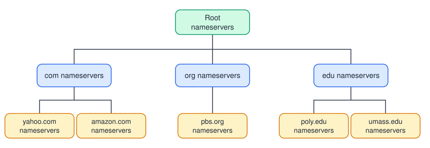
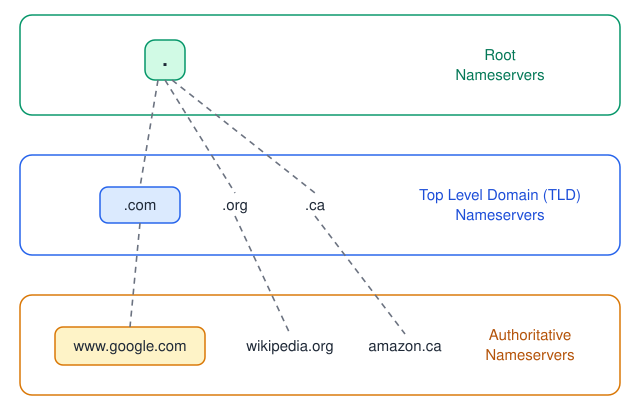
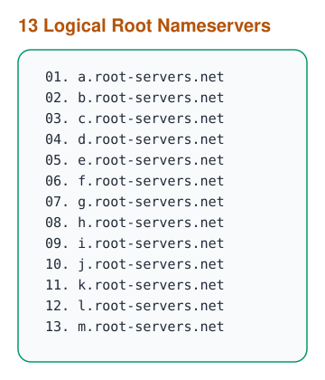
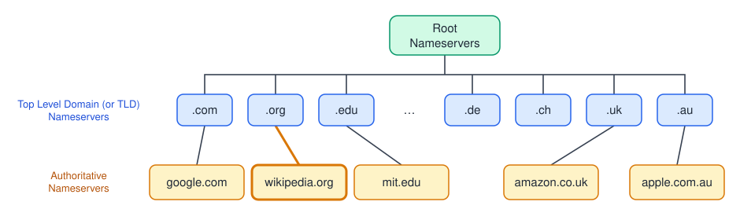
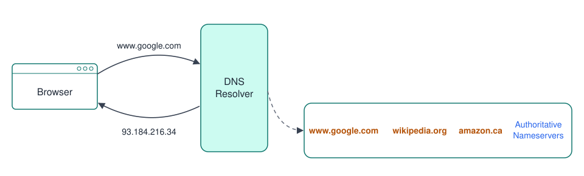
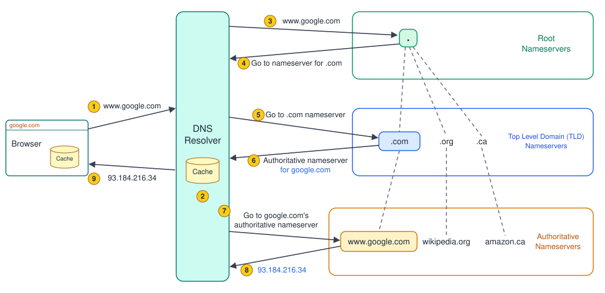

# Domain Name System (DNS)

- [What is DNS?](#what-is-dns)
- [DNS Hierarchy](#dns-hierarchy)
  - [Root Nameservers](#root-nameservers)
  - [TLD Nameservers](#tld-nameservers)
  - [Authoritative Nameservers](#authoritative-nameservers)
- [DNS Resolver](#dns-resolver)
- [How a DNS Lookup Works](#how-a-dns-lookup-works)
- [Recursive vs Iterative Queries](#recursive-vs-iterative-queries)
- [DNS Caching and TTL](#dns-caching-and-ttl)
- [Common DNS Records](#common-dns-records)
- [DNS in System Design](#dns-in-system-design)

> DNS is the **phone book of the internet**. It translates human-readable domain names (`www.google.com`) into machine-readable IP addresses (`93.184.216.34`) that computers use to reach each other.

## What is DNS?

- Humans remember names, machines route on IP addresses. DNS bridges the two.
- It is a **distributed, hierarchical database**. No single server knows every mapping; each level knows only who to ask next.
- This design makes DNS:
  - **Scalable**: load is spread across millions of servers.
  - **Fault tolerant**: no single point of failure, every level is replicated.
  - **Decentralised**: each organisation manages records for its own domain.
- Runs mostly over **UDP port 53** (small, fast queries). Falls back to **TCP port 53** for large responses and zone transfers.

## DNS Hierarchy

Domain names are read **right to left**, and each part maps to a level in the hierarchy:

```
www.google.com.
 │     │    │  └── Root (the implicit trailing ".")
 │     │    └───── TLD (.com)
 │     └────────── Second-level domain (google)
 └──────────────── Subdomain (www)
```

<p align="center">
    
    <br/>
    <i>DNS is a tree of nameservers</i>
</p>

There are three levels of nameservers:

<p align="center">
    
    <br/>
    <i>Root → TLD → Authoritative</i>
</p>

### Root Nameservers

- Top of the hierarchy, represented by the trailing `.` in a domain name.
- They do not know the IP of `www.google.com`. They only know **which TLD nameservers to ask** (e.g., where the `.com` servers are).
- There are **13 logical root nameservers**, named `a` through `m`.
- Each logical server is backed by many physical machines spread across the world using **anycast** (same IP announced from many locations, traffic goes to the nearest one). In total there are well over a thousand physical instances.
- Managed under the coordination of **ICANN/IANA**, operated by organisations like Verisign, NASA, the US Army, RIPE NCC, etc.

<p align="center">
    
    <br/>
    <i>13 logical root nameservers</i>
</p>

### TLD Nameservers

- Store information for every domain under a given top-level domain.
- They point to the **authoritative nameservers** of a specific domain (e.g., `.com` TLD knows where `google.com`'s nameservers are).
- Types of TLDs:
  - **Generic TLDs (gTLD)**: `.com`, `.org`, `.net`, `.edu`, `.io`
  - **Country code TLDs (ccTLD)**: `.in`, `.uk`, `.de`, `.ca`, `.au`
- Managed by **registries** (e.g., Verisign runs `.com` and `.net`).

<p align="center">
    
    <br/>
    <i>Root → TLD → Authoritative nameservers</i>
</p>

### Authoritative Nameservers

- The **final source of truth** for a domain. They hold the actual DNS records (A, AAAA, CNAME, MX, ...).
- When you buy a domain from a **registrar** (GoDaddy, Namecheap, Route 53), the registrar tells the TLD registry which authoritative nameservers serve your domain.
- Usually run by DNS providers such as AWS Route 53, Cloudflare, Google Cloud DNS.

## DNS Resolver

- The browser does not talk to root/TLD/authoritative servers directly. It asks a **DNS resolver** (also called a **recursive resolver**).
- The resolver does the legwork of walking the hierarchy and returns the final IP to the client.
- Typically provided by the **ISP**, or a public resolver like **Google (`8.8.8.8`)** or **Cloudflare (`1.1.1.1`)**.
- The resolver **caches** answers, so most queries never go beyond it.

<p align="center">
    
    <br/>
    <i>Browser asks the resolver, the resolver finds the answer</i>
</p>

## How a DNS Lookup Works

<p align="center">
    
    <br/>
    <i>End-to-end resolution of www.google.com</i>
</p>

1. User types `www.google.com`. The browser checks its own cache (and then the OS cache). On a miss, it sends the query to the **DNS resolver**.
2. The resolver checks **its cache**. If the answer is there, it returns it right away (skip to step 9).
3. On a miss, the resolver asks a **root nameserver** for `www.google.com`.
4. Root replies: *"I don't know, but here are the nameservers for `.com`."*
5. The resolver asks the **`.com` TLD nameserver**.
6. TLD replies: *"Here are the authoritative nameservers for `google.com`."*
7. The resolver asks **google.com's authoritative nameserver**.
8. Authoritative nameserver returns the IP: `93.184.216.34`.
9. The resolver caches the answer and returns the IP to the browser. The browser caches it too and opens a connection to that IP.

> A cold lookup takes several round trips. Thanks to caching at every layer (browser, OS, resolver), most lookups resolve in a few milliseconds.

## Recursive vs Iterative Queries

| Aspect          | Recursive Query                                | Iterative Query                                         |
|-----------------|------------------------------------------------|---------------------------------------------------------|
| Who does work   | Server finds the full answer for the client    | Server returns the best referral it has ("ask X next")  |
| Used between    | Client ↔ DNS resolver                          | DNS resolver ↔ Root / TLD / Authoritative nameservers   |
| Response        | Final IP address (or error)                    | Referral to the next nameserver, or the final answer    |

## DNS Caching and TTL

- Every DNS record has a **TTL (Time To Live)** in seconds, set by the domain owner.
- Caches (browser, OS, resolver) keep the record until the TTL expires, then fetch it again.
- **Trade-off**:
  - **High TTL** (hours/days): fewer lookups, faster, less load, but changes take longer to spread.
  - **Low TTL** (seconds/minutes): changes spread quickly (good for failover), but more queries and higher latency on misses.
- **DNS propagation** is the time it takes for a change to be seen everywhere, which is bounded by the old TTL.
- Tip: before a planned migration, **lower the TTL in advance**, make the change, then raise it again.

## Common DNS Records

| Record  | Purpose                                                    | Example                                  |
|---------|------------------------------------------------------------|------------------------------------------|
| `A`     | Maps a name to an IPv4 address                             | `google.com → 142.250.183.14`            |
| `AAAA`  | Maps a name to an IPv6 address                             | `google.com → 2404:6800:4009::200e`      |
| `CNAME` | Alias from one name to another name                        | `www.example.com → example.com`          |
| `MX`    | Mail server for the domain                                 | `example.com → mail.example.com`         |
| `NS`    | Authoritative nameservers for the domain                   | `example.com → ns1.provider.com`         |
| `TXT`   | Arbitrary text (domain verification, SPF, DKIM)            | `"v=spf1 include:_spf.google.com ~all"`  |
| `SOA`   | Start of authority: primary NS, admin, serial, timers      | One per zone                             |
| `PTR`   | Reverse lookup, IP to name                                 | `34.216.184.93.in-addr.arpa → host`      |

## DNS in System Design

- **DNS-based load balancing**: return multiple `A` records (round robin) so clients spread across servers. It is coarse-grained, because clients cache and DNS has no health awareness by default.
- **GeoDNS / latency-based routing**: return the IP of the nearest data center based on the client's location (e.g., Route 53 latency/geo routing). CDNs rely on this heavily. See [CDN](cdn.md).
- **Failover**: health checks plus a low TTL let DNS stop returning IPs of unhealthy regions.
- **Single point of failure risk**: if your authoritative DNS provider goes down, your service is unreachable even when servers are healthy (e.g., the 2016 Dyn DDoS outage). Mitigate with **multiple DNS providers**.
- **Security**:
  - **DNS spoofing / cache poisoning**: an attacker injects fake records into a resolver cache. Mitigated by **DNSSEC** (cryptographically signed records).
  - **Privacy**: plain DNS is unencrypted. **DoH (DNS over HTTPS)** and **DoT (DNS over TLS)** encrypt queries.

> Related: [Networks: DNS section](networks.md#dns---domain-name-system), [Load Balancing](load-balancing.md)
