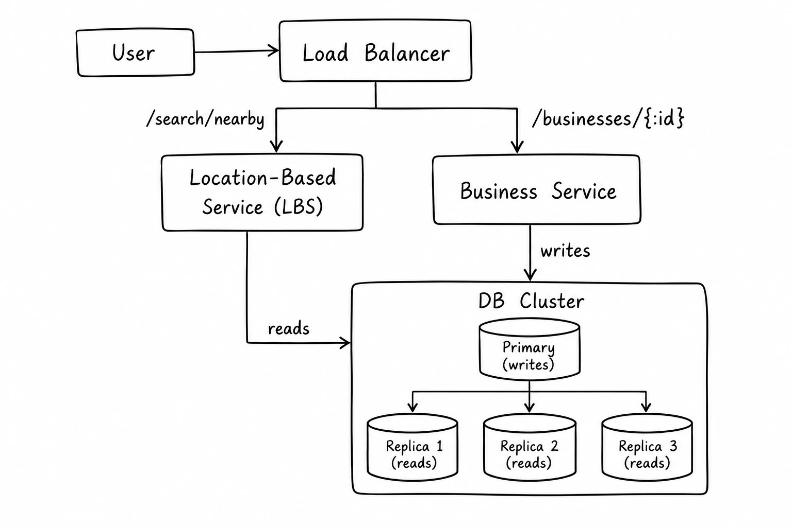
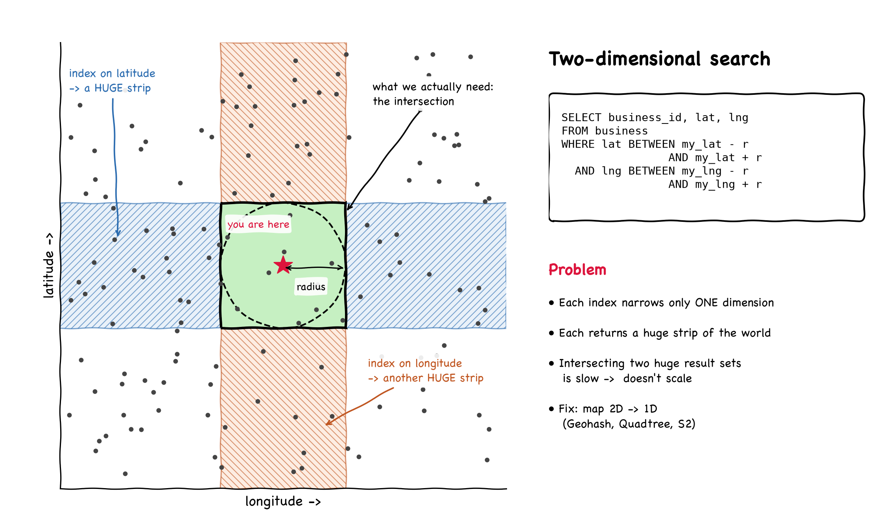

# Location Based Service - Proximity Service

> A proximity service finds nearby places (restaurants, hotels, gas stations, etc.) around a given location.
> - Powers features like "Find nearby restaurants" on Yelp or "Find nearest gas stations" on Google Maps.


## Step 1: Understanding problem statement

> Candidate: Can a user specify the search radius? If no businesses are found in the radius, should we expand the search?
>
> Interviewer: Yes, user can choose a radius. Expanding the search is out of scope - only return businesses within the radius.

> Candidate: What is the maximum radius allowed?
>
> Interviewer: 20 km (12.5 miles).

> Candidate: Can the user change the radius from the UI?
>
> Interviewer: Yes, with fixed options: 0.5 km, 1 km, 2 km, 5 km and 20 km.

> Candidate: How is business information added, deleted or updated? Do changes need to show up in real time?
>
> Interviewer: Business owners make the changes. Newly added/updated businesses can show up the next day.

> Candidate: The user may be moving while using the app. Should results refresh automatically?
>
> Interviewer: No. Assume the user's speed is slow, no constant refresh needed.

### Requirements (Functional)

- Return all businesses based on user's location (latitude, longitude) and radius.
- Business owners can add, delete or update a business. Changes need not be reflected in real time.
- Customers can view detailed information about a business.

### NFEs

- **Low latency**: Users should see nearby businesses quickly.
- **Data privacy**: Location is sensitive data. Comply with privacy laws like GDPR and CCPA.
- **High availability and scalability**: Handle traffic spikes during peak hours in densely populated areas.

### Back of the envelope estimation

- DAU: 100 million
- Number of businesses: 200 million
- Assume a user makes 5 search queries per day.
- Seconds in a day ≈ 24 * 60 * 60 = 86,400 ≈ 10^5 (rounded for easy math)
- **Search QPS** = 100M * 5 / 10^5 = **5,000**


## Step 2: High-level design

### API Design

#### 1. Search nearby businesses
```
GET /v1/search/nearby
```

| Field     | Description                      | Type    |
|-----------|----------------------------------|---------|
| latitude  | Latitude of the given location   | decimal |
| longitude | Longitude of the given location  | decimal |
| radius    | Optional. Default is 5000 meters | int     |

Response:
```json
{
  "total": 10,
  "businesses": [{business object}]
}
```
- The business object contains just enough data to render the search result page (name, address, rating, distance, image).
- Full business details are fetched separately when the user clicks on a business.
- **Pagination** is needed in real life, but skipped here.

#### 2. Business APIs

| API                             | Detail                               |
|---------------------------------|--------------------------------------|
| `GET /v1/businesses/{:id}`      | Return detailed info about a business |
| `POST /v1/businesses`           | Add a business                       |
| `PUT /v1/businesses/{:id}`      | Update details of a business         |
| `DELETE /v1/businesses/{:id}`   | Delete a business                    |

### Data Model

#### Read/Write ratio
- **Read-heavy**: Search nearby businesses and view business details are very frequent.
- **Writes are rare**: Adding/updating/deleting businesses.
- A relational DB like **MySQL** works well for read-heavy systems.

#### Schema

**Business table**

| Column      | Note |
|-------------|------|
| business_id | PK   |
| address     |      |
| city        |      |
| state       |      |
| country     |      |
| latitude    |      |
| longitude   |      |

**Geospatial index table**
- Used for efficient spatial lookups. Discussed in deep dive.

### High Level Architecture

<p align="center">
  
</p>

#### Load Balancer
- Distributes traffic across services based on API path.

#### Location-Based Service (LBS)
- Core of the system. Finds nearby businesses for a given location and radius.
- **Read-heavy, no writes**.
- **High QPS**, especially in dense areas during peak hours.
- **Stateless** -> easy to scale horizontally.

#### Business Service
- Business owners create/update/delete businesses -> **writes, low QPS**.
- Customers view business details -> **reads, high QPS during peak hours**.

#### Database Cluster
- Primary-secondary setup.
- Primary handles writes, replicas handle reads.
- There may be a replication lag between primary and replicas, which is fine since business info doesn't need real-time updates.

#### Scalability of business service and LBS
- Both are stateless -> add servers during peak hours, remove during off hours.
- On cloud, deploy in different regions and availability zones for better availability.


## Algorithms to fetch nearby businesses

> In real life, companies might use existing geospatial DBs like **Geohash in Redis** or **Postgres with PostGIS extension**.
> But in an interview, we should understand how the geospatial index works rather than just naming the DB.

### Option 1: Two-dimensional search

- Draw a circle with the radius and find all businesses within it.

<p align="center">
  
</p>

```sql
SELECT business_id, latitude, longitude
FROM business
WHERE (latitude BETWEEN {:my_lat} - radius AND {:my_lat} + radius)
  AND (longitude BETWEEN {:my_long} - radius AND {:my_long} + radius)
```

- **Problem**: Not efficient - scans the whole table.
- Even with indexes on latitude and longitude, each index returns a huge dataset (a long strip of the world). Taking the **intersection** of the two datasets is slow.
- Issue: Database index can only improve search speed in **one dimension**.
- **Solution idea**: Map 2D data into 1D.

#### Types of geospatial indexes

```
Geospatial Indexing
├── Hash based
│   ├── Even grid
│   ├── Geohash
│   └── Cartesian tiers
└── Tree based
    ├── Quadtree
    ├── Google S2
    └── RTree
```
- Common idea: divide the map into smaller areas and build indexes for fast search.
- We'll focus on **Geohash, Quadtree and Google S2** (most widely used in real life).

### Option 2: Evenly divided grid

- Divide the world into small grids of the same size. A grid can have multiple businesses, and each business belongs to one grid.
- **Problem**: Business distribution is **not even**.
  - Downtown New York has a lot of businesses, while deserts or oceans have none.
- Hard to find neighboring grids for a fixed-size grid.

### Option 3: Geohash

- Converts 2D (lat, long) into a **1D string** of letters and digits.
- Works by **recursively dividing the world into smaller grids** with each extra bit.

#### How it works
1. Divide the world into 4 quadrants along the prime meridian and equator.
   - Latitude range [-90, 0] -> `0`, [0, 90] -> `1`
   - Longitude range [-180, 0] -> `0`, [0, 180] -> `1`
   ```
   ┌──────┬──────┐
   │  01  │  11  │
   ├──────┼──────┤
   │  00  │  10  │
   └──────┴──────┘
   ```
2. Divide each grid into 4 smaller grids. Each grid is represented by alternating longitude bit and latitude bit.
3. Repeat until grid size reaches the desired precision.
4. Represent the bits using **base32**.
   - Example: Google HQ (length 6) -> `9q9hvu`

#### Geohash precision

| Geohash length | Grid width x height   |
|----------------|-----------------------|
| 1              | 5,009.4 km x 4,992.6 km (whole world = 32 grids) |
| 2              | 1,252.3 km x 624.1 km |
| 3              | 156.5 km x 156 km     |
| 4              | 39.1 km x 19.5 km     |
| 5              | 4.9 km x 4.9 km       |
| 6              | 1.2 km x 609.4 m      |
| 7              | 152.9 m x 152.4 m     |
| 8              | 38.2 m x 19 m         |
| 9              | 4.8 m x 4.8 m         |
| ...            | ...                   |
| 12             | 3.7 cm x 1.9 cm       |

- We are interested in length **4 to 6**.
  - Length > 6 -> grid too small.
  - Length < 4 -> grid too large.

#### Choosing precision based on radius
- Pick the minimal geohash length whose grid covers the circle drawn by the radius.

| Radius   | Geohash length |
|----------|----------------|
| 0.5 km   | 6              |
| 1 km     | 5              |
| 2 km     | 5              |
| 5 km     | 4              |
| 20 km    | 4              |

#### Boundary issues

Geohash guarantees: **longer shared prefix -> closer the two geohashes are**. But the reverse is NOT true.

1. **Two close locations with no shared prefix**
   - Two locations very close to each other, but on opposite sides of the equator or prime meridian, belong to different "halves" of the world.
   - Example: Two places in France ~30 km apart -> `u000` and `ezzz`, no common prefix.
   - So a simple prefix query like `WHERE geohash LIKE '9q8zn%'` would miss nearby businesses.

2. **Two positions with long shared prefix but in different geohashes**
   - Two points can be right next to each other, but on either side of a grid boundary.
   - **Solution**: Fetch businesses from the **current grid and its 8 neighbors**.
   - Neighbor geohashes can be computed in **constant time**.

#### Not enough businesses
- If current grid + neighbors don't return enough businesses:
  - **Option 1**: Return only what's within the radius. Simple, but may return too few results.
  - **Option 2**: Increase search radius by **removing the last digit** of the geohash, which expands the grid. Repeat until enough results are found.

### Option 4: Quadtree

- A data structure that **recursively subdivides 2D space into 4 quadrants** until the contents of each grid meet a criteria.
  - Example criteria: Keep subdividing until a grid has **<= 100 businesses**.
- It's an **in-memory data structure**, NOT a database solution.
  - Runs on each LBS server and is built at server start-up time.

```
                 World (200M)
        ┌───────┬──────┴─────┬───────┐
       NW      NE           SW      SE
     (40M)   (30M)        (70M)   (60M)
                            │
                  ┌──────┬──┴───┬──────┐
                 ...    ...    ...    ...   (keep splitting until <= 100)
```

#### Memory needed

| Node type     | Data                                                        | Size       |
|---------------|-------------------------------------------------------------|------------|
| Leaf node     | Top-left & bottom-right coordinates (32 B) + up to 100 business IDs (8 B each) | 32 + 800 = **832 B** |
| Internal node | Top-left & bottom-right coordinates (32 B) + 4 child pointers (8 B each) | 32 + 32 = **64 B** |

- Number of leaf nodes ≈ 200M / 100 = **2 million**
- Number of internal nodes ≈ 2M * 1/3 ≈ **0.67 million**
- Total memory ≈ 2M * 832 B + 0.67M * 64 B ≈ **1.71 GB**
- Fits easily in one server's memory. (Still may need multiple servers to handle read QPS.)

#### Build time
- O((n/100) * log(n/100)), n = number of businesses.
- For 200M businesses -> takes **a few minutes**.

#### Searching
1. Build the quadtree in memory.
2. Start from the root, traverse until we find the leaf node containing the search origin.
3. If the leaf has enough businesses (e.g. 100), return them. Else, add businesses from **neighboring** nodes until enough are found.

#### Operational considerations
1. **Server startup time**
   - Building the tree takes a few minutes, server can't serve traffic during this time.
   - Roll out new releases **incrementally** to a small subset of servers at a time. Avoid taking a large cluster offline at once.
   - Blue/green deployment could make all new servers fetch 200M businesses from the DB at the same time -> heavy DB load.
2. **Updating the quadtree** when businesses are added/removed
   - **Option 1**: Rebuild incrementally - update a small subset of servers at a time across the cluster. Some servers will return stale data for a while. Fine, since requirement allows next-day updates.
     - Can also be done with a **nightly job**.
   - **Option 2**: Update the tree on the fly.
     - Complicated - multiple threads may access the tree at the same time -> needs **locking**.
     - Rebalancing may be needed when a leaf can't hold more businesses.

> Real-world: **Yext** uses a quadtree for proximity search.

### Option 5: Google S2

- An in-memory library, like Quadtree.
- Maps a sphere to a 1D index using the **Hilbert curve** (a space-filling curve).
  - Property: Two points close to each other on the Hilbert curve are also close in 1D space.
  - Search in 1D space is much more efficient than in 2D.
- Pros:
  - Great for **geofencing** - define perimeters (virtual boundaries) around areas of interest and notify users entering/leaving them.
  - **Region Cover algorithm** - can cover arbitrary areas with cells of varying levels (min level, max level, max cells). More flexible and granular than fixed geohash precision.
- Used by Google, Tinder, etc.
- Hard to explain in an interview. Prefer Geohash or Quadtree.

### Geohash vs Quadtree

| Geohash | Quadtree |
|---------|----------|
| Easy to use and implement. No need to build a tree. | Slightly harder to implement since it needs to build a tree. |
| Supports returning businesses within a specified radius. | Supports fetching **k-nearest** businesses (good for "return me 5 nearest gas stations" regardless of distance). |
| Grid size is **fixed** by precision. Can't dynamically adjust based on density. | Grid size **dynamically adjusts** based on population density -> more accurate results. |
| Updating the index is easy. Removing a business = removing a row (geohash, business_id). | Updating is more complicated. Need to traverse from root to leaf -> **O(log n)**. Needs locking if multi-threaded. Rebalancing can be tricky. |

> Companies using Geohash: Bing Maps, Redis, MongoDB, Lyft
>
> Companies using Quadtree: Yext, Elasticsearch (with geohash too)


## Step 3: Design Deep Dive

### Scale the database

#### Business table
- Data may not fit in one server -> **shard by business_id**.
- Load is evenly distributed and operationally easy to maintain.

#### Geospatial index table

Two ways to structure the table:

**Option 1**: Each geohash key has a JSON array of business IDs in a single row.

| geohash | list_of_business_ids |
|---------|----------------------|

- Updating requires fetching the array, scanning it for the business to update/remove.
- Inserting requires scanning for duplicates.
- Needs **locking** to prevent concurrent updates.

**Option 2 (Recommended)**: Multiple rows, one row per business in a geohash.

| geohash | business_id |
|---------|-------------|

- Compound key -> (geohash, business_id).
- Adding/removing a business is simple: insert/delete a row. No locking needed.

#### Scaling the geospatial index
- Geospatial index data is **not large** (quadtree index ~1.71 GB, geohash similar). Fits in memory of one modern server.
- But read volume may be too high for one server.
- **Sharding is complex** here (sharding logic in application layer) and not needed.
- **Better: Read replicas** to handle the read load.

### Caching

> Before adding a cache, ask: **Is it really needed?**
> - Workload is read-heavy and dataset is small -> it may fit in memory of a DB server; adding read replicas can be enough.
> - Benchmark and cost analysis should guide the decision.

#### Cache key
- **Using raw (lat, long) is a bad idea**:
  - Location from phones is approximate and changes slightly with every request even if the user is not moving.
  - User moving slightly changes the coordinates -> no cache hits.
- **Use geohash (or quadtree grid)** as the cache key. All locations within a grid map to the same key.

#### Types of data to cache

| Key           | Value                                      |
|---------------|--------------------------------------------|
| geohash       | List of business IDs in the grid           |
| business_id   | Business object (for rendering search results and detail page) |

#### Caching data in grids
- Business data is relatively stable, so precompute the list of business IDs for each geohash.
- On a new business add/update/delete -> update the DB and **invalidate cache**. Since requirement allows next-day reflection, it's fine.
- Support 3 precisions (geohash lengths **4, 5, 6**) for the radius options.

**Memory estimate**:
- Each value (business ID) = 8 bytes
- 200M businesses * 8 B * 3 precisions ≈ **5 GB**
- Fits in a single Redis server, but deploy a **Redis cluster globally** for high availability and reduced cross-continent latency.

### Region and Availability Zones

- Deploy LBS to multiple regions and availability zones.
  - Users are physically closer to the system -> lower latency.
  - Spread traffic evenly - dense areas (e.g. Japan, Korea) can be served by separate regions or even multiple AZs.
  - **Privacy laws**: Some countries require user data to be stored locally. DNS routing can route requests to the correct region.

### Follow up: Filter results by time or business type

- e.g. "Return restaurants that are open now".
- Once we get the businesses from the geohash grid (current + neighbors), the number of results is **relatively small**.
- So it's fine to fetch business IDs first, then hydrate business objects and **filter by opening time / business type** in the service.
- Assumes opening time and type are stored in the business table.

### Final Design

```
                        ┌──────────────┐
            User ──────▶│Load Balancer │
                        └──────┬───────┘
                ┌──────────────┴───────────────┐
                ▼                              ▼
     ┌─────────────────────┐        ┌──────────────────┐
     │        LBS          │        │ Business Service │
     └───┬─────────────┬───┘        └───┬──────────┬───┘
         │             │                │          │ writes
         ▼             ▼                │          ▼
  ┌────────────┐ ┌──────────────┐       │   ┌──────────────┐
  │Redis:      │ │Redis:        │◀──────┘   │ DB Primary   │
  │Geohash ->  │ │Business info │           └──────┬───────┘
  │business IDs│ │              │                  │ replication
  └─────▲──────┘ └──────▲───────┘           ┌──────▼───────┐
        │               │                   │ DB Replicas  │
        └───────────────┴───── nightly job ─┴──────────────┘
                         (sync cache from DB)
```

#### Get nearby businesses
1. Client sends user location (lat, long) and radius (e.g. 500 m) to the load balancer.
2. LB forwards the request to LBS.
3. LBS maps radius to geohash length (500 m -> length 6).
4. LBS calculates the current geohash and its **8 neighbors** -> 9 geohashes.
5. For each geohash, LBS calls the **Geohash Redis** to fetch business IDs (calls run in **parallel** to reduce latency).
6. LBS fetches business objects from the **Business info Redis**, calculates distance between user and each business, **ranks** them and returns to the client.

#### View, update, add or delete a business
- All business-related APIs are handled by Business Service, separate from LBS.
- View: Check cache first (Business info Redis). On cache miss, fetch from DB and populate the cache.
- Add/Update/Delete: Write to DB. Changes are reflected the next day; a **nightly job** updates the cache.


## Step 4: Wrap Up

- Started with a naive 2D search and saw why it doesn't scale.
- Discussed geospatial indexing options: **even grid, Geohash, Quadtree, Google S2**.
- Deep dives:
  - Geohash vs Quadtree tradeoffs.
  - Geospatial index table design (one row per business).
  - Scaling with **read replicas** instead of sharding the index.
  - **Caching** with geohash as the key.
  - Multi-region deployment for latency and privacy laws.
  - Filtering results by time/type.

### Key Takeaways
- Database indexes only help in one dimension -> map 2D location to 1D (geohash / space-filling curves).
- Always query **current grid + 8 neighbors** to handle boundary issues.
- Read-heavy + small dataset -> **replicate, don't shard**.
- Cache keys must be **stable** -> use geohash, not raw coordinates.


## Resources
- [Geohash explorer](https://geohash.softeng.co/)
- [Google S2 Geometry](https://s2geometry.io/)
- [Redis geospatial commands](https://redis.io/docs/latest/develop/data-types/geospatial/)
- [PostGIS](https://postgis.net/)
